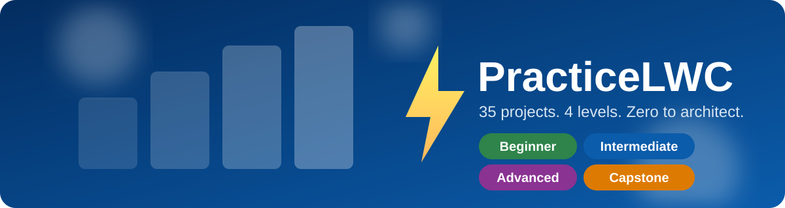
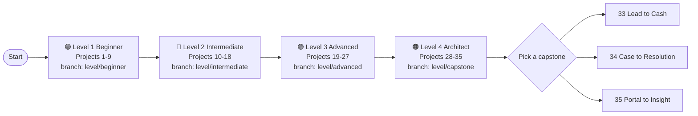
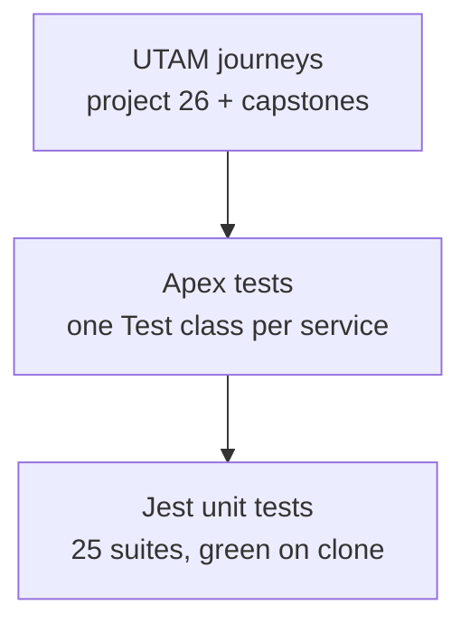

# PracticeLWC

[](https://github.com/prakash426/practicelwc/actions/workflows/ci.yml)
[](https://developer.salesforce.com/docs/platform/salesforce-release-notes)
[](docs/testing.md)
[](https://prettier.io)
[](LICENSE)



**PracticeLWC is a hands on Lightning Web Components curriculum: 35 real business scenario projects that take you from your first `hello` component to architect level capstones.** Every project ships working code, passing tests, and its own guide. No stub tests, no slideware.

- 🟢 **Level 1 Beginner** (1-9): components, data, forms, wizards, events
- 🔵 **Level 2 Intermediate** (10-18): Apex, approvals, GraphQL, state, console, Flow
- 🟣 **Level 3 Advanced** (19-27): CPQ, offline, realtime, TypeScript, SSR, UTAM, security
- 🟠 **Level 4 Architect** (28-35): identity, omnichannel, Lightning Out 2.0, 3 capstones

## Learning path



> Follow the branches in order: `main` → `develop` → `level/beginner` → `level/intermediate` → `level/advanced` → `level/capstone`. Each level branch holds that level's projects; `develop` integrates everything. See [docs/branching.md](docs/branching.md).

## Project matrix

<details open>
<summary><b>🟢 Level 1: Beginner (1-9)</b> — first components to LWS clean downloads · <code>level/beginner</code> · <a href="docs/level-1-beginner.md">level guide</a></summary>

| # | Project | Key skills | Solution | Guide |
|---|---|---|---|---|
| 1 | Hello Lead Card | Template, `@api`, `getRecord`, illustration fallback | `force-app/.../helloLeadCard` | [guide](docs/projects/01-hello-lead-card/README.md) |
| 2 | Lead Worklist Table | `@wire` Apex, datatable, `refreshApex`, toasts | `force-app/.../leadWorklistTable` | [guide](docs/projects/02-lead-worklist-table/README.md) |
| 3 | Lead Convert Form | Record edit form, imperative Apex, navigation | `force-app/.../leadConvertForm` | [guide](docs/projects/03-lead-convert-form/README.md) |
| 4 | Knowledge Self-Help Finder | Debounce, accordion, LMS publish, `lwc:on` | `force-app/.../knowledgeFinder` | [guide](docs/projects/04-knowledge-finder/README.md) |
| 5 | Case Creator with Attachments | LMS subscribe, `createRecord`, file upload | `force-app/.../caseCreator` | [guide](docs/projects/05-case-creator-attachments/README.md) |
| 6 | Project Intake Wizard | Multi step wizard, validation, progress | `force-app/.../projectIntakeWizard` | [guide](docs/projects/06-project-intake-wizard/README.md) |
| 7 | Dynamic Event Playground | `lwc:on` event maps, mode switching | `force-app/.../eventPlayground` | [guide](docs/projects/07-dynamic-event-playground/README.md) |
| 8 | Record Header Widgets | Builder props, view form, SLDS hooks | `force-app/.../recordHeaderWidgets` | [guide](docs/projects/08-record-header-widgets/README.md) |
| 9 | Download Center | `Blob` CSV download, LWS lint, empty state | `force-app/.../downloadCenter` | [guide](docs/projects/09-download-center/README.md) |

Shared with every level: `utilsLib`, `errorPanel`, `emptyStateWrap`, `Project__c`, `SearchTerm` channel.


</details>

<details>
<summary><b>🔵 Level 2: Intermediate (10-18)</b> — Apex, approvals, GraphQL, state · <code>level/intermediate</code> · <a href="docs/level-2-intermediate.md">level guide</a></summary>

| # | Project | Key skills | Solution | Guide |
|---|---|---|---|---|
| 10 | Discount Eligibility Checker | Imperative Apex, `{ data, errors }` | `force-app/.../discountChecker` | [guide](docs/projects/10-discount-checker/README.md) |
| 11 | Approval Inbox | Datatable inbox, modal, platform events | `force-app/.../approvalInbox` | [guide](docs/projects/11-approval-inbox/README.md) |
| 12 | GraphQL Opportunity Explorer | `@wire(graphql)` reads, tree grid | `force-app/.../graphqlOppExplorer` | [guide](docs/projects/12-graphql-opportunity-explorer/README.md) |
| 13 | GraphQL Mutations Editor | `executeMutation`, inline edit | `force-app/.../graphqlOppEditor` | [guide](docs/projects/13-graphql-mutations-editor/README.md) |
| 14 | Shared Cart State | LWC State Management singleton | `force-app/.../cartApp` | [guide](docs/projects/14-shared-cart-state/README.md) |
| 15 | Agent Console Workspace | Console APIs, LMS siblings, macros | `force-app/.../agentConsoleWorkspace` | [guide](docs/projects/15-agent-console-workspace/README.md) |
| 16 | Partner Portal Dashboard | Experience targets, sharing safe Apex | `force-app/.../partnerPortalDashboard` | [guide](docs/projects/16-partner-portal-dashboard/README.md) |
| 17 | Flow Handoff | Nav to Flow, local flow actions | `force-app/.../flowHandoff` | [guide](docs/projects/17-flow-handoff/README.md) |
| 18 | Notification Center | Custom notifications, live badge | `force-app/.../notificationCenter` | [guide](docs/projects/18-notification-center/README.md) |


</details>

<details>
<summary><b>🟣 Level 3: Advanced (19-27)</b> — CPQ, offline, realtime, TS, SSR, UTAM · <code>level/advanced</code> · <a href="docs/level-3-advanced.md">level guide</a></summary>

| # | Project | Key skills | Solution | Guide |
|---|---|---|---|---|
| 19 | CPQ Lite Wizard | Orchestrator, tree grid, pricing rules | `force-app/.../cpqLiteWizard` | [guide](docs/projects/19-cpq-lite-wizard/README.md) |
| 20 | Quote PDF Delivery | Schedulable plus invocable PDF, email | `force-app/.../quotePdfDelivery` | [guide](docs/projects/20-quote-pdf-delivery/README.md) |
| 21 | Field Day Planner | `lightning-map`, drag reschedule, live status | `force-app/.../fieldDayPlanner` | [guide](docs/projects/21-field-day-planner/README.md) |
| 22 | Offline Technician App | Offline first, drafts, conflict UX | `force-app/.../offlineTechApp` | [guide](docs/projects/22-offline-technician-app/README.md) |
| 23 | Realtime Ops Dashboard | Manual DOM charts, Trusted Mode boundary | `force-app/.../opsDashboard` | [guide](docs/projects/23-realtime-ops-dashboard/README.md) |
| 24 | TypeScript Data Grid | `.ts` authoring, typed events (Preview) | `force-app/.../typedDataGrid` | [guide](docs/projects/24-typescript-data-grid/README.md) |
| 25 | SSR Product Catalog | Light DOM, SSR safe render | `force-app/.../ssrProductCatalog` | [guide](docs/projects/25-ssr-product-catalog/README.md) |
| 26 | UTAM E2E Track | Page objects, quote to cash journey | `utam/` | [guide](docs/projects/26-utam-e2e-track/README.md) |
| 27 | Secure File Hub | LWS hardening, audit checklist | `force-app/.../secureFileHub` | [guide](docs/projects/27-secure-file-hub/README.md) |


</details>

<details>
<summary><b>🟠 Level 4: Architect and Capstones (28-35)</b> — identity, omnichannel, LO2, E2E demos · <code>level/capstone</code> · <a href="docs/level-4-architect.md">level guide</a></summary>

| # | Project | Key skills | Solution | Guide |
|---|---|---|---|---|
| 28 | Multi-Brand Identity and Consent Console | Consent toggles, audit, segregation | `force-app/.../identityConsentConsole` | [guide](docs/projects/28-identity-consent-console/README.md) |
| 29 | EX-Rated Offline Workbench | Offline at scale, thresholds | `force-app/.../offlineWorkbench` | [guide](docs/projects/29-offline-workbench/README.md) |
| 30 | Omnichannel Support Hub | Bot handoff, routing, analytics tiles | `force-app/.../omnichannelHub` | [guide](docs/projects/30-omnichannel-hub/README.md) |
| 31 | LWC Beyond Salesforce (Lightning Out 2.0) | Declarative tag, OAuth, host page | `force-app/.../lo2Embed` + `sites/lo2-demo` | [guide](docs/projects/31-lightning-out-embed/README.md) |
| 32 | Release-Gated Feature Lab | Preview channels, HMR, Error Console | `force-app/.../featureLab` | [guide](docs/projects/32-release-feature-lab/README.md) |
| 33 | Capstone A: Lead to Cash | Web lead → signed quote PDF | `force-app/.../leadToCash` | [guide](docs/projects/33-capstone-lead-to-cash/README.md) |
| 34 | Capstone B: Case to Resolution | Self help → console → field fix | `force-app/.../caseToResolution` | [guide](docs/projects/34-capstone-case-to-resolution/README.md) |
| 35 | Capstone C: Portal to Insight | Portal + SSR + Out 2.0, one package | `force-app/.../portalToInsight` | [guide](docs/projects/35-capstone-portal-to-insight/README.md) |


</details>

> 🎬 **Demo GIFs wanted.** Each level section above carries a placeholder until a maintainer records the flow on a scratch org and saves it as `images/demo/level-<1-4>-<name>.gif`. See [CONTRIBUTING.md](CONTRIBUTING.md).

## Quickstart

**Recommended path: scratch org.**

```bash
git clone https://github.com/prakash426/practicelwc.git
cd practicelwc
npm install
sf org login web --alias devhub --set-default-dev-hub

npm run org:create   # scratch org from config/project-scratch-def.json
npm run org:push     # deploy force-app
npm run org:open     # open in browser

npm run test:unit    # Jest, green on clone
npm run lint         # ESLint with LWC rules
```

Full setup, teardown, and troubleshooting: [docs/setup.md](docs/setup.md) · [docs/troubleshooting.md](docs/troubleshooting.md).

## Testing



- **Jest:** `npm run test:unit` (watch: `npm run test:watch`). Shared mocks in `force-app/test/jest-mocks/`.
- **Apex:** every service has a `*Test` class; run with `sf apex run test --wait 10 --code-coverage`.
- **UTAM:** page objects in `utam/`; run with `npm run test:ui`.

Details: [docs/testing.md](docs/testing.md). Offline rules that also apply to projects 22 and 29: [docs/offline.md](docs/offline.md).

## Repository map

```text
practicelwc/
  README.md  LICENSE  CONTRIBUTING.md  CHANGELOG.md
  sfdx-project.json  package.json  jest.config.js  eslint.config.js
  config/project-scratch-def.json  manifest/package.xml
  force-app/main/default/   # lwc/ classes/ objects/ messageChannels/ ...
  force-app/test/jest-mocks/
  utam/                     # page objects + quote-to-cash journey (project 26)
  sites/lo2-demo/           # Lightning Out 2.0 host page (project 31)
  docs/
    curriculum.md  setup.md  branching.md  testing.md  offline.md  troubleshooting.md
    level-1-beginner.md ... level-4-architect.md
    projects/<nn>-<slug>/README.md   # 35 guides
    manifests/  research/
  .github/workflows/ci.yml
  images/hero.svg  images/demo/
```

Curriculum source of truth: [docs/curriculum.md](docs/curriculum.md). Per batch build notes: [docs/manifests/](docs/manifests/). Background research: [docs/research/](docs/research/).

## Contributing

One project, one branch (`project/<nn>-<slug>` from its `level/*` branch), green tests, docs with code. Start with [CONTRIBUTING.md](CONTRIBUTING.md) and the [branching model](docs/branching.md).

## Attribution

Built on and indebted to official Salesforce documentation and samples:

- [Lightning Web Components Developer Guide](https://developer.salesforce.com/docs/platform/lwc/overview) and [lwc.dev](https://lwc.dev) (wire adapters, SSR, `lwc:on`, GraphQL)
- [Lightning Web Security](https://developer.salesforce.com/docs/platform/lwc/guide/security-lwsec-intro) (the `Blob` over `data:` rule behind projects 9, 20, 27)
- [Lightning Data Service and GraphQL wire adapters](https://developer.salesforce.com/docs/platform/lwc/guide/data-ui-api-graphql-wire) (projects 12, 13, 22)
- [Lightning Out 2.0](https://developer.salesforce.com/docs/platform/lwc/guide/use-lightning-out) (project 31)
- [UTAM and Salesforce Mobile Offline guides](https://developer.salesforce.com/docs/platform/mobile-sdk) (projects 22, 26, 29)
- [LWC Recipes](https://github.com/trailheadapps/lwc-recipes), [ebikes-lwc](https://github.com/trailheadapps/ebikes-lwc), and [dreamhouse-lwc](https://github.com/trailheadapps/dreamhouse-lwc) sample apps (patterns and structure inspiration)

## License

MIT. See [LICENSE](LICENSE).
