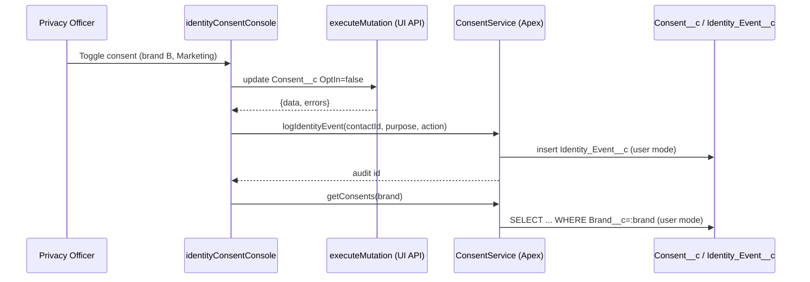

# 28. Multi-Brand Identity + Consent Console

Level: Architect. Time: 4h. API v67. Branch: `project/28-identity-consent-console`.
Covers batch themes: **admin toolkit** + **design-system showcase** (consent toggles, audit table).

Business scenario R1: privacy officer manages consent across brands at scale.
Persona: platform architect + privacy officer.

## Architecture
- LWC `identityConsentConsole`: brand picker, consent toggle matrix (per Contact x purpose), Shield event-log viewer.
- Writes via `executeMutation` (UI API) so consent changes work without custom Apex writes; reads/audit via Apex `ConsentService` (with sharing, user mode).
- Brand segregation enforced in Apex (brand filter on every query) + verified by sharing tests.
- CSP-safe: no inline scripts, SLDS styling hooks only.

## Acceptance
- Consent change audits to Identity_Event__c.
- Brand B admin cannot see brand A data (Apex sharing tests).
- Jest covers toggle matrix (opt-in/out/error).
