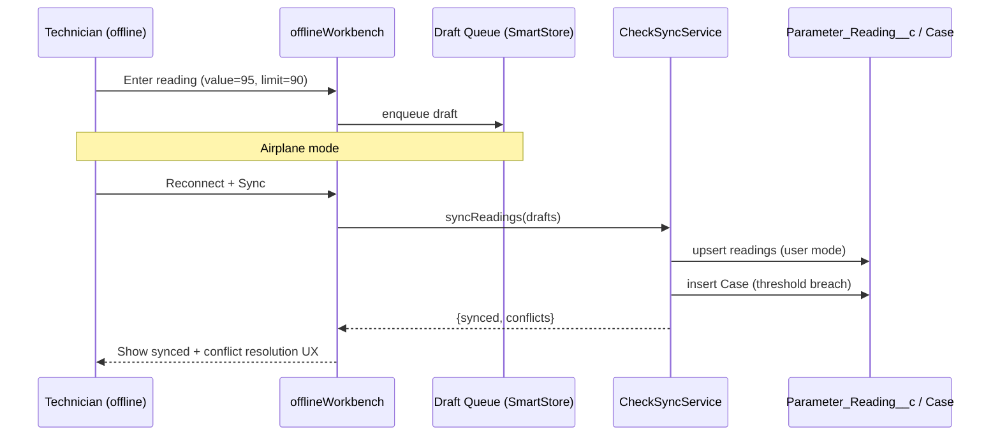

# 29. EX-Rated Offline Workbench

Level: Architect. Time: 5h. API v67. Branch: `project/29-offline-workbench`.
Covers batch themes: **admin toolkit** (threshold admin) + offline-first field pattern at scale.

Business scenario R2: hazardous-zone equipment checks offline + trending.
Persona: field technician (EX zones) + reliability engineer.

## Architecture
- LWC `offlineWorkbench`: reading entry form (explicit fields, statically analyzable), queued-draft list (SmartStore pattern), threshold breach banner, sync/conflict UI.
- Online: `CheckSyncService` upserts readings (user mode), creates Case on threshold breach.
- Offline: drafts queue locally; on reconnect, push + resolve conflicts (server-wins with user confirm).
- Briefcase Builder: Equipment_Check__c + Parameter_Reading__c, limits 50K/object, 5 briefcases, 10 rules, 3 levels.
- Uses `lightning/uiGraphQLApi` v1 + explicit-field `getRecord` only (never by-layout, never graphql v2 offline).

