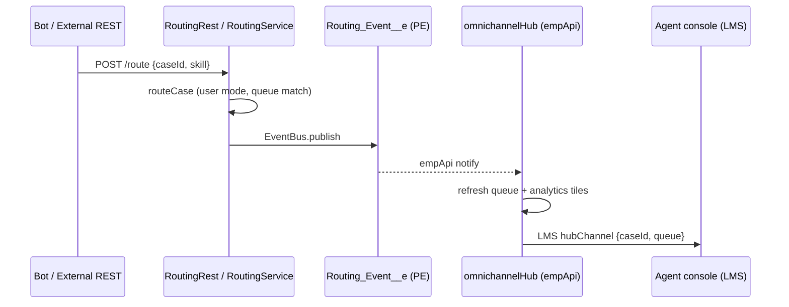

# 30. Omnichannel Support Hub

Level: Architect. Time: 5h. API v67. Branch: `project/30-omnichannel-hub`.
Covers batch themes: **integration (REST/Platform Events/CDC)** + **analytics dashboard** (routing + volume tiles).

Business scenario R3: dynamic-sharing hub unifying bot, console, portal.
Persona: enterprise architect + agent.

## Architecture
- LWC `omnichannelHub`: channel tabs (bot/console/portal), routing queue (datatable), live event feed via `lightning-emp-api` (platform event `Routing_Event__e`), mini analytics tiles (volume by channel).
- Apex `RoutingService`: `routeCase` (queue assignment, user mode), `publishRoutingEvent` (EventBus), `@RestResource RoutingRest` for external bot posts.
- CDC on Case refreshes hub; LMS `hubChannel` syncs sibling console components.
- Dynamic sharing respected: queue query filters by running user's groups.

