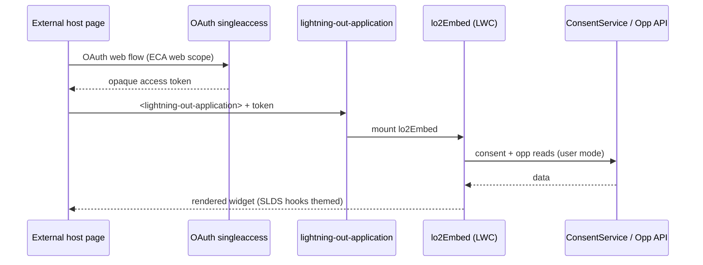

# 31. LWC Beyond Salesforce (Lightning Out 2.0)

Level: Architect. Time: 3h. API v67. Branch: `project/31-lightning-out-embed`.
Covers batch themes: **micro-frontend composition** (LO2 widget in external host).

Business scenario R1/R3: embed consent widget + deal-risk card in external web app.
Persona: B2B app team dev.

## Architecture
- LWC `lo2Embed`: consent summary + deal-risk card, light DOM, SLDS styling-hook overrides for host theming.
- Exposed via `<lightning-out-application>` declarative tag; auth via OAuth 2.0 `/services/oauth2/singleaccess` opaque tokens + External Client App (`web` scope); CORS allowlist.
- No Aura, no session ID, guest blocked by design.
- `sites/lo2-demo/index.html`: plain HTML host; `scripts/smoke.sh`: curl token + page check.

