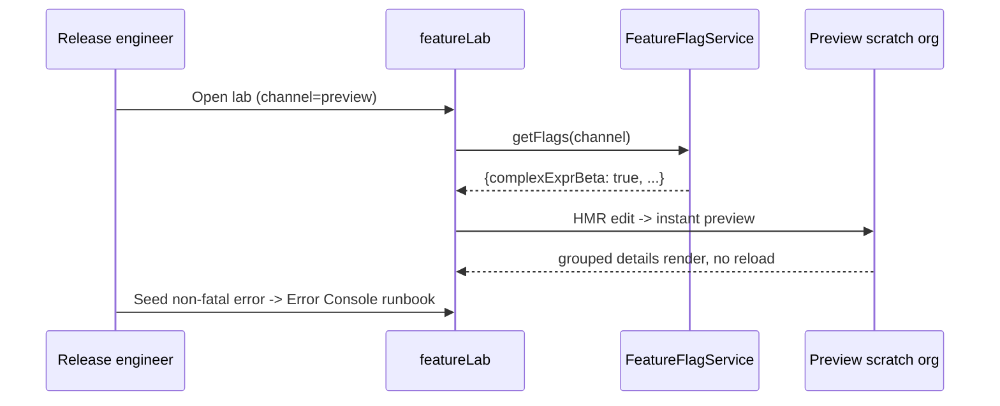

# 32. Release-Gated Feature Lab

Level: Architect. Time: 2h. API v67. Branch: `project/32-release-feature-lab`.
Covers batch themes: **design-system showcase** (SLDS patterns, zero-JS accordions, HMR demo).

Business scenario R3: team previews upcoming LWC features safely per channel.
Persona: release engineer.

## Architecture
- LWC `featureLab`: grouped `
` accordions (zero JS), Component Preview embed notes, HMR loop demo card, Error Console triage runbook section.
- Apex `FeatureFlagService`: returns channel-gated flags (user mode, custom metadata read).
- Release Manager Standard/preview channels: validate one Beta feature per preview scratch with rollback notes in README appendix.

