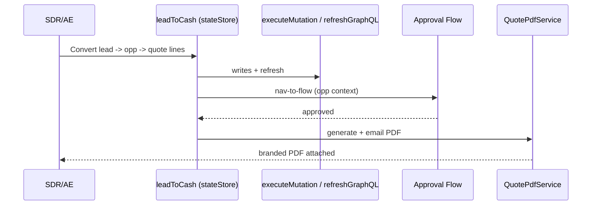

# 33. Capstone A: Lead-to-Cash (Sales)

Level: Capstone. Time: 6h. API v67. Branch: `project/33-capstone-lead-to-cash`.
Covers batch themes: **approval + Flow embedding** + **full end-to-end demo app** (sales leg).

Composes projects 2, 3, 10, 11, 13, 19, 20. No new objects.
Demo: web lead -> opp -> guided quote -> approval -> PDF in under 10 minutes.

## Architecture
- `leadToCash` orchestrator: embeds worklist + editor + wizard via `stateStore`, nav-to-flow approval (`standard__flow` + `flow__` state), PDF status screen.
- Writes via `executeMutation` + `refreshGraphQL`; approval via Flow + `ApprovalService`.
- UTAM journey extension: `leadToCash.utam.json` covers quote-to-approval path.

