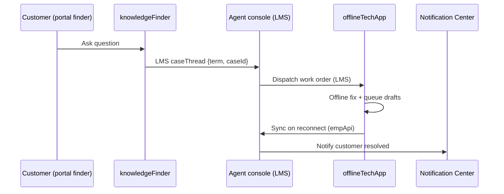

# 34. Capstone B: Case-to-Resolution (Service)

Level: Capstone. Time: 6h. API v67. Branch: `project/34-capstone-case-to-resolution`.
Covers batch themes: **full end-to-end demo app** (service leg) + **Experience Cloud portal widgets** (self-help finder embed).

Composes projects 4, 5, 15, 21, 22. No new objects.
Demo: question -> case -> console -> field fix incl. offline leg.

## Architecture
- `caseToResolution`: LMS thread (`caseThread`) from finder -> case creator -> console -> field app; empApi live status; notification center wiring.
- Offline field leg reuses project 22 pattern (queued drafts + sync).
- UTAM journey extension covers finder-to-resolution path.

