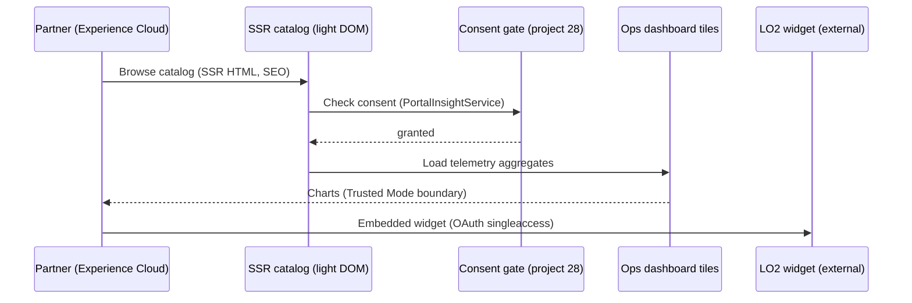

# 35. Capstone C: Portal-to-Insight (Platform)

Level: Capstone. Time: 6h. API v67. Branch: `project/35-capstone-portal-to-insight`.
Covers batch themes: **Experience Cloud portal widgets** + **analytics dashboard** + **micro-frontend composition** + **full end-to-end demo app** (platform leg).

Composes projects 16, 23, 25, 28, 30. No new objects.
Demo: portal -> consent -> telemetry -> dashboard; one unlocked package.

## Architecture
- `portalToInsight`: Experience Builder page composition: SSR catalog front door (light DOM, guarded window), consent-gated portal widgets (project 28), ops dashboard tiles with Trusted-Mode chart boundary, LO2 external widget slot.
- Apex `PortalInsightService`: consent check + aggregated telemetry (user mode, cacheable).
- Packaging: single unlocked package version installs portal + SSR + Out 2.0.

