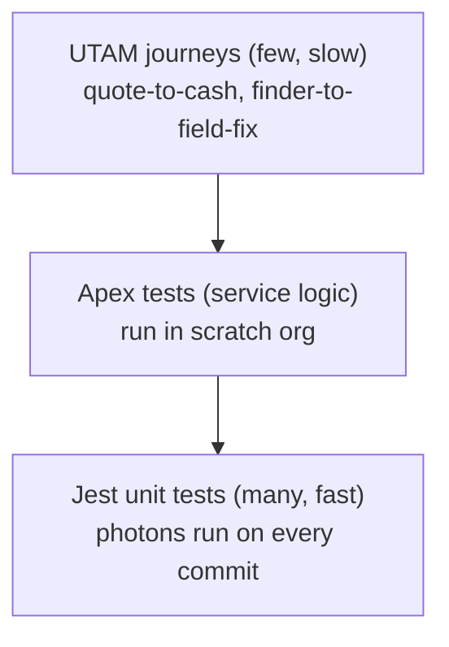

# Testing guide

PracticeLWC uses a three layer pyramid: Jest unit tests, Apex tests, and UTAM end to end journeys.

## Jest (LWC unit tests)

- Every Level 1 project ships `__tests__`; Levels 2 to 4 ship Jest where client logic is testable (see each batch manifest in `docs/manifests/`).
- Run all: `npm run test:unit`. Watch mode: `npm run test:watch`.
- Shared wire and Apex mocks live in `force-app/test/jest-mocks/`.
- Coverage thresholds (70 percent lines, branches, functions) are enforced in `jest.config.js`.

## Apex tests

- Every service class has a `*Test` class. All Apex uses `with sharing` plus `WITH USER_MODE`; tests assert sharing behavior where it matters (portal, consent).
- Run in your scratch org: `sf apex run test --wait 10 --result-format human --code-coverage`.

## UTAM (UI journeys)

- Page objects live in `utam/` (`quoteWizard.utam.json`, `approvalInbox.utam.json`). Run with `npm run test:ui` (needs a target org plus WebDriver config in `utam/wdio.conf.js`).
- Keep journeys under 20. Prefer `data-*` and `aria-*` locators over CSS or XPath.

## CI

`.github/workflows/ci.yml` runs Prettier, ESLint (with LWC rules), and Jest on every push. The scratch deploy lane runs only when `DEVHUB_SFDX_AUTH_URL` is configured as a repo secret.
